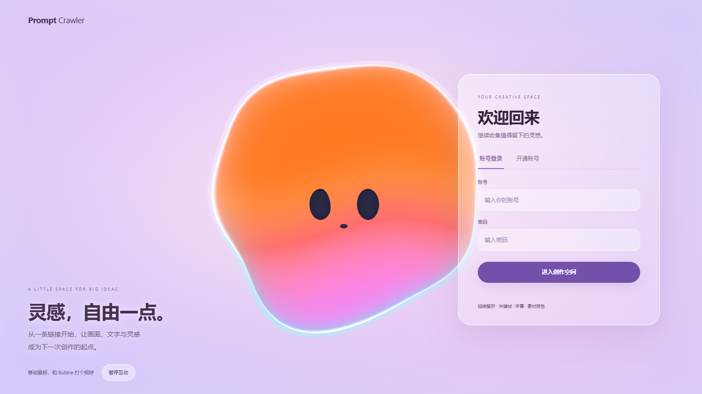
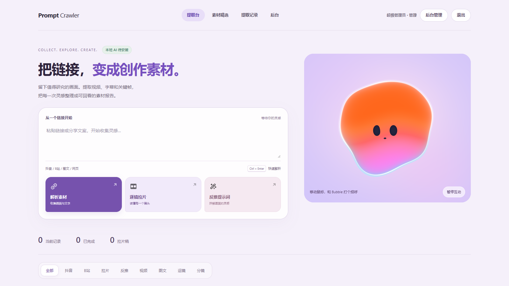

# Prompt Crawler · 灵感采集与视频拆解

把散落在链接里的内容，整理成可以继续创作的素材。

Prompt Crawler 是一个在自己电脑上运行的网页工具：粘贴分享链接，提取正文、图片、视频关键帧与字幕，整理提示词，导出 Word 报告。界面采用紫粉色玻璃效果与可交互的 WebGL 泡泡背景。

**本地模型，无需付费 API Key。** GitHub 提供源码和下载包，实际处理在你的电脑上完成。





## 功能

- 链接提取：抖音、B站视频/图文，以及部分文章与社交平台链接。
- 视频拆解：下载可访问的视频、抽取关键帧、保留时间码，支持拉片与首帧提示词反推。
- 本地识别：faster-whisper 生成字幕、OpenCC 转简体、RapidOCR 提取画面文字。
- 可选本地视觉模型：Qwen3.5-2B + llama.cpp，辅助画面描述、分类与汇总。
- 素材管理：搜索筛选、账号与记录权限、字幕/素材下载、Word 报告导出。
- 证据优先：模型未安装或识别失败时，报告保留已有素材并说明缺失，不把模板句冒充画面分析。

平台登录、反爬策略与内容权限会影响解析成功率；不能保证任意链接均可下载。只处理你有权访问和使用的内容。

## Windows 快速开始

目前完整安装流程面向 **Windows 10/11 64 位 + Python 3.12**。CPU 可运行，无需独立显卡；建议 16 GB 内存，并为浏览器、依赖和模型预留至少 8 GB 空间。长视频与本地视觉分析耗时取决于 CPU，不能保证实时完成。

1. 在本仓库的 **Releases** 下载 `Prompt-Crawler-v1.0.0-Windows-Source.zip`，解压到自己的文件夹。也可以通过 **Code → Download ZIP** 下载源码。
2. 安装 [Python 3.12](https://www.python.org/downloads/)；安装时勾选添加到 PATH。
3. 安装包含 `ffmpeg` 和 `ffprobe` 的 FFmpeg，并加入 PATH。Windows 可在终端运行：

   ```powershell
   winget install --id Gyan.FFmpeg --exact
   ```

   安装后重新打开终端。分别执行 `ffmpeg -version`、`ffprobe -version` 确认可以找到。
4. 双击 `install.bat`：创建独立 `.venv`，安装 Python 依赖和 Chromium 浏览器。若浏览器下载失败，会尝试使用电脑上已安装的 Chrome/Edge（独立会话，不读取你的个人浏览器资料）。首次安装需要联网。
5. 双击 `start_server.bat`，看到启动地址后打开 **http://127.0.0.1:5000**。
6. 首次启动会生成随机管理员密码：打开 `data/first-run-admin.txt`，使用其中的 `admin` 账号和密码登录。该文件属于私密信息；保存好密码后可删除。

保留运行窗口；关闭窗口即停止服务。后续只需运行 `start_server.bat`。

### 开启免费本地视觉分析

双击 `install_local_ai.bat`，下载 llama.cpp Windows CPU 运行时、Qwen3.5-2B Q4 模型及视觉投影文件。下载量约数 GB，可断点续传，文件校验通过后才会安装。下载源为 GitHub 与 Hugging Face，网络不可达时需稍后重试。

模型保存在 `.local-ai/`，不随源码包分发。首次视觉请求会自动启动本地模型进程；没有安装模型时，基础网页与素材管理仍能使用，视觉分析会提示不可用。

字幕模型默认使用 Whisper `base`，首次识别时自动下载；可通过 `PROMPT_CRAWLER_ASR_MODEL` 改成 `tiny`（更轻量）、`small`（更占资源）或本地模型目录。RapidOCR 首次使用也可能需要下载模型。下载后的推理在本机执行，链接抓取本身仍需联网。

## 手动运行

```powershell
py -3.12 -m venv .venv
.\.venv\Scripts\python.exe -m pip install -r requirements.txt
.\.venv\Scripts\python.exe -m playwright install chromium
.\.venv\Scripts\python.exe run_server_with_extensions.py
```

可选安装视觉模型：

```powershell
.\.venv\Scripts\python.exe tools\install_local_ai.py
```

## 配置

环境变量在启动之前设置。示例：`$env:PROMPT_CRAWLER_PORT = "5001"`。

| 变量 | 默认值 | 用途 |
| --- | --- | --- |
| `PROMPT_CRAWLER_HOST` | `127.0.0.1` | 监听地址；可信局域网共享时可设为 `0.0.0.0` |
| `PROMPT_CRAWLER_PORT` | `5000` | 网页端口 |
| `PROMPT_CRAWLER_ADMIN_PASSWORD` | 首次随机生成 | 仅首次创建管理员时使用，至少 12 字符；不重置已有账号 |
| `PROMPT_CRAWLER_SECRET` | 自动生成并保存 | Flask 会话密钥；通常无需设置 |
| `PROMPT_CRAWLER_ASR_MODEL` | `base` | Whisper 模型名或本地路径 |
| `PROMPT_CRAWLER_ASR_LANGUAGE` | 自动识别 | 需要固定中文时设为 `zh` |
| `PROMPT_CRAWLER_BROWSER_CHANNEL` | 自动选择 | 可设为 `chrome` 或 `msedge`，使用已安装浏览器 |
| `PROMPT_CRAWLER_COOKIE_FILE` | 未设置 | yt-dlp 的 Netscape 格式 Cookie 文件路径，仅用于其下载回退流程 |

视觉模型参数在 `local_ai_config.py`。本地推理地址限制为回环地址，没有云端模型回退。

这是个人电脑/可信局域网工具；当前版本没有完整的公网服务加固，不建议直接把端口暴露到互联网。GitHub Pages 不能运行本项目的 Python 后端。

## 数据与更新

`data/` 保存账号、数据库和会话密钥；`douyin_images/`、`bilibili_media/` 保存下载素材；`.local-ai/` 保存模型。这些目录均不会进入版本库。

更新前停止程序，备份这些目录；解压新版本后恢复自己的数据，再运行安装脚本更新依赖。不要将 `first-run-admin.txt`、Cookie、数据库或模型缓存上传到公开仓库。问题反馈请去 **Issues**，附系统版本与已去掉隐私信息的错误日志。

## 开发与验证

```powershell
.\.venv\Scripts\python.exe -m unittest discover -s tests -v
```

测试覆盖本地推理限制、报告证据处理、首次账号初始化、登录访问控制、字幕时间码和下载适配。单元测试不等于所有平台链接、所有硬件或全部模型均已实测。

## 许可

项目代码使用 [MIT License](LICENSE)。第三方组件与模型的许可见 [THIRD_PARTY_NOTICES.md](THIRD_PARTY_NOTICES.md)。欢迎下载、修改、反馈问题和提交 Pull Request。
